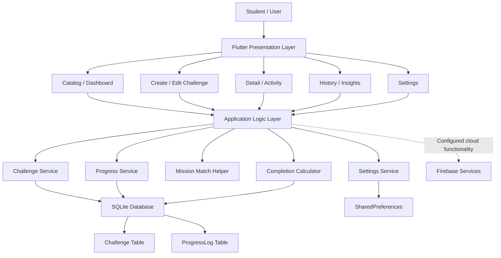
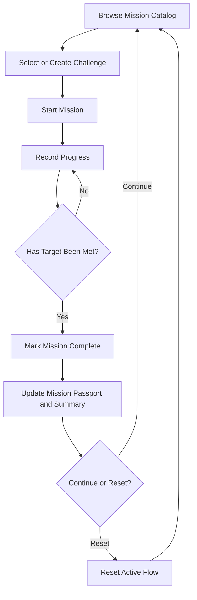

# System Architecture

## Architecture Overview

Campus Challenge follows a layered mobile application architecture that separates the presentation layer, application logic layer, and data layer.

**Main Architecture:** Flutter UI -> Application Logic -> Data Layer -> SQLite / SharedPreferences / Firebase

Each layer has a specific responsibility:

- **Presentation Layer:** Displays the five main screens, mission cards, forms, filters, progress controls, and Mission Passport.
- **Application Logic Layer:** Handles challenge CRUD, progress-log CRUD, validation, filtering, completion calculations, mission lifecycle rules, and Mission Match suggestions.
- **Data Layer:** Provides methods for creating, reading, updating, and deleting stored information.
- **SQLite:** Stores challenges and progress logs in a local relational database.
- **SharedPreferences:** Stores lightweight user settings and preferences.
- **Firebase:** Provides cloud functionality for services that are explicitly configured and implemented.

The application is designed to keep core mission records available without an internet connection.

## System Architecture Diagram



## Presentation Layer
The presentation layer is built with Flutter and Dart. It displays information and collects user input through reusable widgets.

### Screen Responsibilities
| Screen | Responsibilities |
|--------|------------------|
| Catalog/Dashboard | Display mission cards, category filters, and the completed-count summary. |
| Create/Edit | Validate and save challenge information, including a positive target. |
| Detail/Activity | Start missions, record progress, finish missions, and reset the active flow. |
| History/Insights | Display progress history and manage individual progress logs. |
| Settings | Save the default target, celebration preference, and display settings. |

### Widget Design
- **Stateless Widgets:** Mission cards, category labels, and reusable display components that do not manage their own changing state.
- **Stateful Widgets:** Progress forms, target sliders, filters, and controls whose values or displayed states change through user interaction.
- **Dialogs:** Confirm destructive actions, including challenge deletion and resets that could affect saved information.
- **Feedback Components:** Display validation errors, successful saves, failed writes, empty states, and completion status.

## Application Logic Layer
The application logic determines how challenges and progress records behave.

### Challenge Management
The challenge service supports:

- Creating a challenge.
- Viewing available challenges.
- Updating challenge details.
- Deleting a challenge according to the defined deletion policy.
- Filtering challenges by category.
- Validating challenge titles and positive targets.

Editing a challenge should preserve its linked progress history. Deleting a challenge must follow the selected database deletion policy and clearly communicate any effect on associated progress logs.

### Progress Management
The progress service supports:

- Adding a progress log.
- Retrieving logs for a selected challenge.
- Editing an existing log.
- Deleting a log.
- Validating nonnegative integer progress.
- Ensuring that each progress log references a valid challenge.

When a progress log changes, the application refreshes the relevant mission status, completion summary, and Mission Passport display.

### Completion Calculator
The completion calculator derives mission status from saved progress and the current challenge target.

For example, if a challenge has a target of 5 units and its saved progress totals 5 units, the target has been met.

Conceptually:

```text
totalProgress = sum of valid progress units
                for the selected challenge

isComplete = totalProgress >= targetUnits

completedCount = number of challenges
                 whose current targets are met
```

The completed-count summary is derived from current records rather than stored as an independent reward value. This prevents incorrect totals when progress is edited or deleted or a challenge target changes.

If the application supports resetting an active mission, reset behavior must be defined separately from deleting progress logs. Saved history must not be silently removed by a reset.

## Local Data Layer
The data layer separates database operations from the user interface. Screens should use application services or repository methods instead of directly managing SQL statements.

### SQLite Database
SQLite stores two related entities: `Challenge` and `ProgressLog`.

### Challenge Table
| Field | Suggested Type | Purpose |
|-------|----------------|---------|
| `id` | INTEGER PRIMARY KEY | Unique challenge identifier. |
| `title` | TEXT NOT NULL | Challenge title. |
| `category` | TEXT NOT NULL | Category used for filtering and matching. |
| `targetUnits` | INTEGER NOT NULL | Positive target required for completion. |
| `description` | TEXT | Optional challenge details. |

### ProgressLog Table
| Field | Suggested Type | Purpose |
|---|---|---|
| `id` | INTEGER PRIMARY KEY | Unique progress-log identifier. |
| `challengeId` | INTEGER NOT NULL | References the associated challenge. |
| `loggedAt` | TEXT NOT NULL | Stores the date and time of the entry. |
| `units` | INTEGER NOT NULL | Nonnegative integer progress amount. |
| `note` | TEXT | Optional progress description. |

### Entity Relationship
```text
Challenge (1) ----------- (Many) ProgressLog
      id                       challengeId
```

One challenge can have multiple progress logs. Each progress log belongs to one challenge.

### Integrity Rules
- A challenge target must be greater than zero.
- Progress units must be nonnegative integers.
- Each progress log must reference a valid challenge through a foreign key.
- Database constraints and application validation should work together.
- Parent deletion must follow a clearly defined policy.

**Deletion Policy:** Use restricted parent deletion when a challenge has linked progress logs. The application should explain that history exists and require the user to resolve the linked records before deleting the challenge. 

If cascading deletion is chosen instead, the application must communicate that deleting the challenge also deletes its linked progress logs and require confirmation.

## SharedPreferences
SharedPreferences stores small settings that do not require relational database queries.

Suggested preferences include:
- `defaultTarget`: The default positive target for new challenges.
- `celebrationEnabled`: Whether completion celebrations are enabled.
- `reducedMotion`: Whether reduced-motion behavior is preferred.
- `preferredCategory`: The user's preferred Mission Match category, if this preference is persisted.

These settings are restored when the application restarts.

SharedPreferences should not store challenge records, progress histories, or derived completion counts. Those belong in SQLite.

## Firebase Integration
Firebase is included in the technology stack for configured cloud functionality.

Uses include:
- **Firebase Authentication:** User sign-in and account management.
- **Cloud Firestore or another configured Firebase data service:** Cloud storage or synchronization if required.
- **Firebase Cloud Messaging:** Notifications if notification functionality is added.

### Inputs
- Preferred challenge category.
- Available challenge categories.
- Current progress and target status of each challenge.

### Decision Process
1. Retrieve available challenges.
2. Check whether the catalog contains any challenges.
3. Validate the preferred category.
4. Evaluate each challenge's category and completion status.
5. Score eligible challenges according to the matching rules.
6. Select the highest-scoring challenge.
7. Resolve equal scores by selecting the lower challenge ID.
8. Display the suggested mission and a short explanation.

### User Override
The user can choose:
- **View details:** Open the selected challenge.
- **Not now:** Dismiss the suggestion without starting the mission.

### Edge Cases
| Case | Expected Behavior |
|------|-------------------|
| Normal input | Suggest the unfinished challenge matching the preferred category when it has the highest score. |
| Empty catalog | Display "Add a challenge first." |
| Invalid preference | Show clear feedback and do not treat an unknown category as a valid match. |
| Equal scores | Select the challenge with the lower ID. |
| Target already met | Mark the challenge as complete using the completion rules. |
| Preferred challenge is complete | Prefer an unfinished alternative when the scoring rules allow it; otherwise explain the result. |

## Mission Lifecycle
The mission lifecycle describes the main user journey.



The lifecycle must distinguish between recording progress, meeting the target, and resetting the active flow.

The application must not create duplicate completion results when a user repeatedly presses Finish. A mission's completion status must be recalculated whenever relevant progress logs or target values change.

Resetting a mission must not silently delete saved history.

## Data Flow Examples

### Adding a Challenge

1. The user opens Create/Edit.
2. The user enters a title, category, description, and target.
3. Flutter validates the form.
4. The application logic confirms that the target is positive.
5. The data layer inserts the challenge into SQLite.
6. The dashboard refreshes and displays the new mission.
7. If saving fails, the application displays an error and does not falsely report success.

### Logging Progress

1. The user opens a mission's Detail/Activity screen.
2. The user enters a progress amount and optional note.
3. The application validates the input.
4. The progress service saves the log with its `challengeId`.
5. The completion calculator reads the current records.
6. The application refreshes the mission status, history, and completed-count summary.

### Restarting Offline

1. The application saves challenges and progress logs in SQLite.
2. Settings are saved in SharedPreferences.
3. The application closes or the device restarts.
4. The user opens the application without internet access.
5. The application reloads local records and preferences.
6. The dashboard recalculates completion information from the saved data.

## Reliability and Error Handling

The application should handle failures without losing existing records or presenting misleading results.

- Validate form input before saving.
- Handle database errors and failed writes.
- Prevent invalid or duplicate completion transitions.
- Confirm destructive actions.
- Refresh derived information after relevant database changes.
- Display useful empty states instead of blank screens.
- Preserve linked history when editing a challenge.
- Restore records and settings after restart.
- Keep core mission tracking available offline.
- Use accessible labels, readable status text, and alternatives to gesture-only controls.

## Summary

Campus Challenge uses Flutter and Dart for its cross-platform interface, SQLite for relational mission data, SharedPreferences for lightweight settings, and Firebase for explicitly configured cloud services.

Its two-entity local model keeps challenges connected to their progress histories. Application logic validates changes, manages the mission lifecycle, and recalculates completion status. Mission Match helps users select challenges, while the Mission Passport celebrates progress derived from saved evidence.

The architecture prioritizes understandable workflows, reliable local persistence, accurate progress tracking, accessible interactions, and a clear separation between user-interface code and data management.